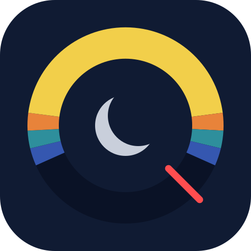
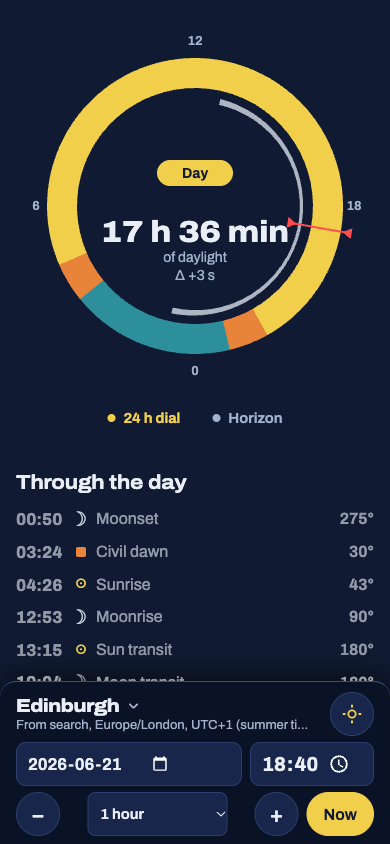
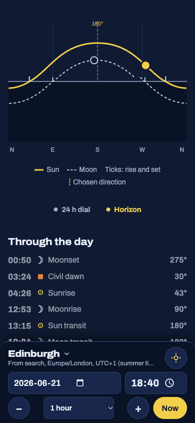

# Is it dark yet?

A small web app that answers when the sun and the moon rise and set, how long the twilight lasts and where in the sky they are, for any place and any moment.

**Live:** <https://mcavity.github.io/is-it-dark-yet/>

<p>
  
  
</p>

## What it shows

- **24-hour dial:** day, civil, nautical and astronomical twilight and night as coloured bands, the hours the moon is up, a marker for now, and the day length with its change since yesterday.
- **Horizon chart:** the paths of the sun and the moon across the sky, centred on where the sun stands highest (south, or north in the southern hemisphere).
- **Through the day:** every dawn, sunrise, transit, sunset and dusk of the sun and the moon in time order, with the compass bearing.
- **Moon:** phase, illumination, age and the next quarters. **Seasons:** equinoxes and solstices.
- **When is the sun at this bearing:** the times the sun shines from a chosen direction, e.g. into a window.
- Any place (search, GPS or coordinates), any time zone, any date; favourites; English, Polish, French and German.

It also handles the awkward cases: polar day and night, twilight that lasts all day at the poles, two dusks of one kind in a day, and the days the clocks change.

## How it calculates

- Positions come from [Astronomy Engine](https://github.com/cosinekitty/astronomy) (MIT), included in `src/vendor/`.
- Sunrise and sunset are the moments the sun's upper edge touches the horizon, with atmospheric refraction (the centre at −0.833°). Civil, nautical and astronomical twilight end at −6°, −12° and −18°.
- Times are shown to the minute.

## Privacy

This is a hobby project with no accounts, cookies, analytics or ads.

- **In your browser:** all calculations run on your device. The chosen place (which can be your GPS position), favourites, language and settings are saved in the browser's local storage on your device only; clearing the site data removes them. The GPS position is never sent anywhere.
- **Place search:** when you type in the search field, the text you type and the interface language are sent to [Open-Meteo](https://open-meteo.com/)'s geocoding service, which, like any server, sees your IP address. Open-Meteo states that it keeps such logs for up to 90 days ([terms](https://open-meteo.com/en/terms)). Nothing is sent if you don't search.
- **Hosting:** the site is served by GitHub Pages, which logs visitors' IP addresses for security ([GitHub Privacy Statement](https://docs.github.com/en/site-policy/privacy-policies/github-general-privacy-statement)).
- **Questions:** open an issue in this repository.

## Development

You need [Bun](https://bun.sh). The app has no runtime dependencies; TypeScript and Bun's types are dev dependencies for the type check.

```sh
bun install
bun run test        # tests
bun run typecheck   # strict type check
bun run build       # type check, then a static build in dist/ (relative URLs, works under any path)
bun run serve       # build and serve at http://localhost:8787/clock/
```

The code: `src/astro.ts` turns Astronomy Engine output into what the app shows, `src/time.ts` handles time zones with `Intl` only, `src/view/` renders the screens as plain HTML strings, `src/main.ts` wires them to the page, and `src/i18n/` holds the four languages.

## Credits

- [Astronomy Engine](https://github.com/cosinekitty/astronomy) by Don Cross, MIT License.
- Place search by [Open-Meteo](https://open-meteo.com/), with data from [GeoNames](https://www.geonames.org/), [CC BY 4.0](https://creativecommons.org/licenses/by/4.0/).
- [Archivo](https://github.com/Omnibus-Type/Archivo) typeface by Omnibus-Type, SIL Open Font License (`src/fonts/OFL.txt`).

## License

[MIT](LICENSE)
